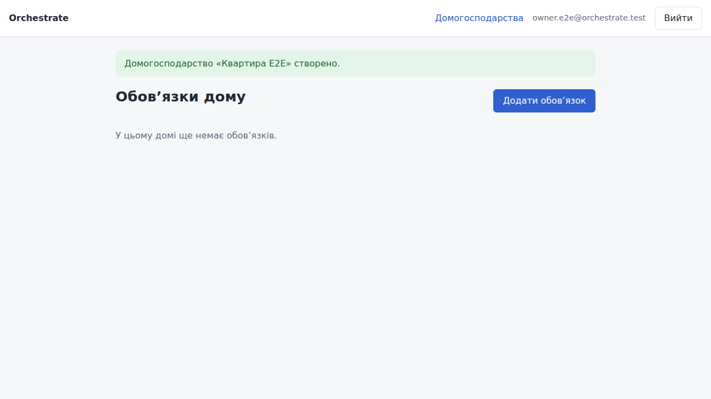
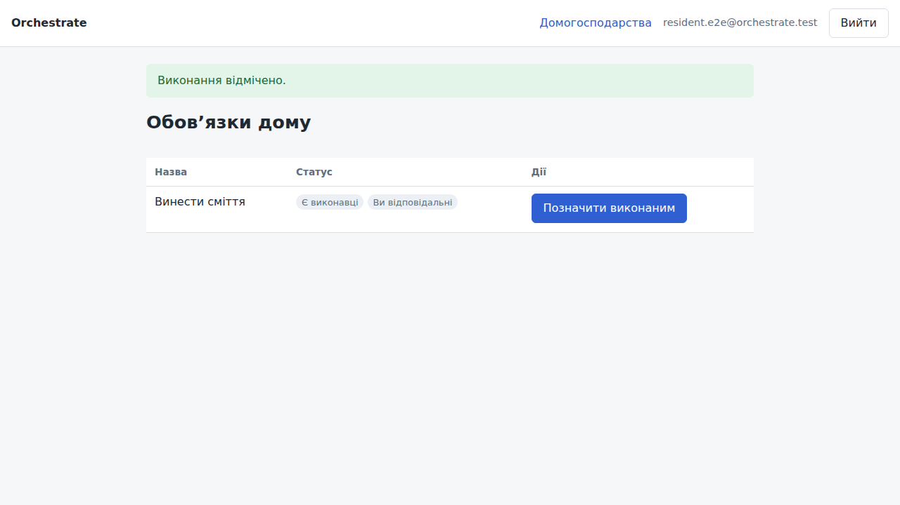
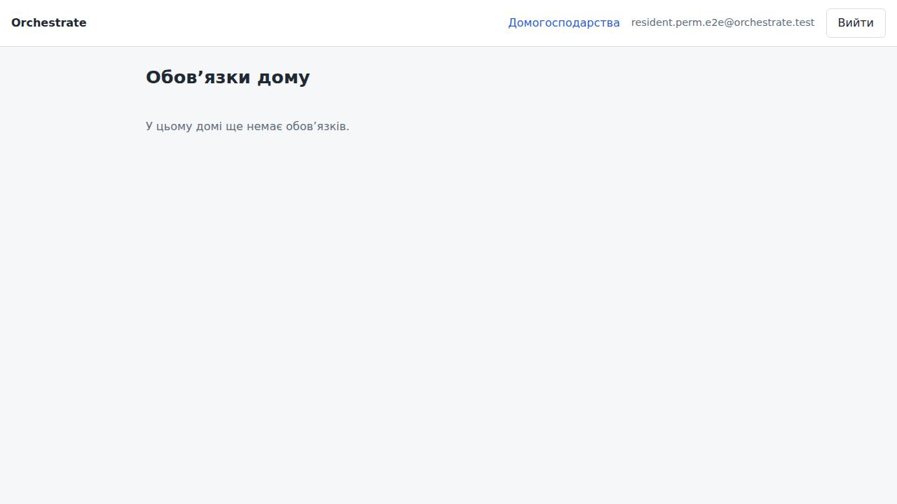
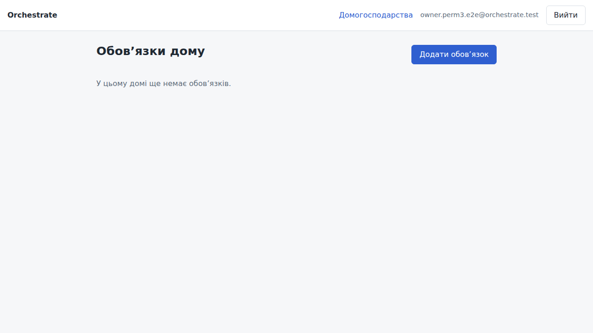
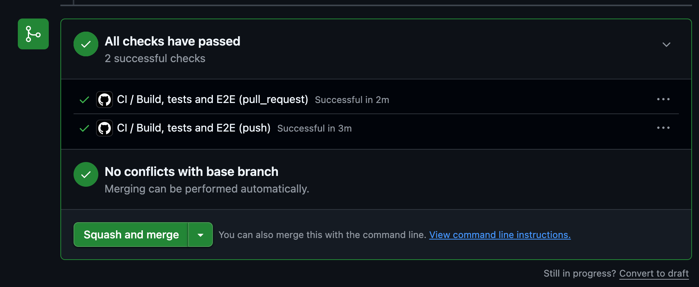

# Звіт: браузерні (E2E) тести, розділення рівнів і CI

Гілка: `andrii-e2e-browser`. Основа: `main` (`6b50e0e`). Pull Request: https://github.com/phylaren/orchestrate/pull/17

## 1. Структура тестів за рівнями

| Рівень | Імена класів | Запуск | Залежність | Кількість (CI) |
|---|---|---|---|---|
| Модульні (швидкі) | `*Test` без Spring-контексту | `./gradlew test` | немає | 302 |
| Веб-зрізи | `*ControllerTest`, `*WebUiIntegrationTest`, `*WebErrorAdviceTest`, `*WebSecurityTest` (`@WebMvcTest`, MockMvc) | `./gradlew test` | немає | 164 |
| Інтеграційні | `*IntegrationTest`, `*ApiIntegrationTest`, `*PersistenceTest`, `*SmokeTest` | `./gradlew test` | Docker (Testcontainers, PostgreSQL) | 124 |
| Наскрізні браузерні (E2E) | `*E2EIT` у пакетах `e2e` і `integration` | `./gradlew e2eTest` | Docker, Chromium (Playwright) | 7 |

Розділення налаштовано в `build.gradle.kts` (нові рядки в кінці файлу):
- `test` виключає `**/*E2EIT*`;
- `e2eTest` включає лише `**/*E2EIT*`, передає каталог артефактів `build/e2e-artifacts` і вмикає збереження trace та скриншотів (`e2e.artifacts.always=true`);
- `check` залежить від `e2eTest`, тож `./gradlew check` запускає все;
- `installPlaywright` завантажує Chromium з системними залежностями.

Розподіл за класами (з CI-звітів, сортування за часом):

| Клас | Тестів | Час |
|---|---|---|
| `AuthAndHouseholdE2EIT` | 1 | 11.74 с |
| `ChoreCompletionApiIntegrationTest` | 12 | 4.49 с |
| `ChoreApiIntegrationTest` | 11 | 4.15 с |
| `HouseholdApiIntegrationTest` | 11 | 3.75 с |
| `SwapRequestApiIntegrationTest` | 8 | 3.02 с |
| `ChorePermissionE2EIT` | 3 | 2.74 с |
| `ModularityTests` | 3 | 1.78 с |
| `CoreDomainScenarioIntegrationTest` | 4 | 1.65 с |
| `WebUiIntegrationTest` | 9 | 1.46 с |
| `ChoreParticipationE2EIT` | 1 | 1.32 с |
| `SecurityFlowIntegrationTest` | 4 | 1.12 с |
| `CoreFlowE2EIT` | 2 | 1.11 с |
| `UserApiIntegrationTest` | 7 | 1.10 с |
| `OpenApiDocumentationTest` | 5 | 0.95 с |
| `PasswordEncoderConfigTest` | 3 | 0.81 с |
| `HouseholdServiceIntegrationTest` | 2 | 0.64 с |
| `ChoreBoardWebControllerTest` | 5 | 0.58 с |
| `SwapRequestServiceImplTest` | 33 | 0.45 с |
| `HouseholdServiceImplTest` | 41 | 0.45 с |
| `OrchestrateApplicationTests` | 1 | 0.42 с |
| `UserAuthenticationIntegrationTest` | 2 | 0.36 с |
| `ChorePersistenceTest` | 5 | 0.34 с |
| `HouseholdPersistenceTest` | 14 | 0.33 с |
| `DevUserSeederIntegrationTest` | 1 | 0.32 с |
| `ChoreWebControllerTest` | 21 | 0.32 с |
| `ChoreCompletionServiceImplTest` | 22 | 0.28 с |
| `UserPersistenceTest` | 10 | 0.26 с |
| `SwapRequestControllerTest` | 28 | 0.19 с |
| `E2ESetupSmokeTest` | 1 | 0.18 с |
| `RotationServiceImplTest` | 24 | 0.17 с |
| `ChoreControllerTest` | 11 | 0.15 с |
| `ChoreCompletionControllerTest` | 8 | 0.15 с |
| `ChoreWebTemplatesTest` | 8 | 0.14 с |
| `ChoreAssignmentControllerTest` | 2 | 0.13 с |
| `UserServiceImplTest` | 7 | 0.11 с |
| `SwapRequestPersistenceTest` | 15 | 0.10 с |
| `ChoreParticipantServiceImplTest` | 12 | 0.09 с |
| `WebErrorAdviceTest` | 4 | 0.09 с |
| `HouseholdMemberControllerTest` | 7 | 0.08 с |
| `AuthenticationManagerConfigTest` | 2 | 0.08 с |
| `ChoreWebSecurityTest` | 5 | 0.08 с |
| `HouseholdControllerTest` | 8 | 0.08 с |
| `JwtAuthenticationFilterTest` | 6 | 0.08 с |
| `JwtServiceTest` | 6 | 0.07 с |
| `HouseholdCreateWebControllerTest` | 4 | 0.07 с |
| `HouseholdInvitationControllerTest` | 6 | 0.06 с |
| `SecurityConfigurationTest` | 8 | 0.05 с |
| `HouseholdWebControllerTest` | 4 | 0.05 с |
| `SwapRequestServicePersistenceTest` | 6 | 0.05 с |
| `ChoreParticipantControllerTest` | 4 | 0.04 с |
| `HouseholdPermissionsControllerTest` | 4 | 0.04 с |
| `UserControllerTest` | 7 | 0.04 с |
| `AuthControllerTest` | 5 | 0.04 с |
| `UserAdminWebControllerTest` | 3 | 0.04 с |
| `ChoreRotationControllerTest` | 2 | 0.03 с |
| `TurnSwapRequestedEventListenerTest` | 2 | 0.02 с |
| `CreateChoreFormValidationTest` | 30 | 0.02 с |
| `ConfirmationStatusTest` | 24 | 0.02 с |
| `UserHouseholdControllerTest` | 2 | 0.02 с |
| `ChoreLifecycleServiceImplTest` | 10 | 0.02 с |
| `PostgresMigrationIntegrationTest` | 2 | 0.01 с |
| `RandomInvitationCodeGeneratorTest` | 2 | 0.01 с |
| `JwtValidatorServiceTest` | 7 | 0.01 с |
| `DevProfileNotificationTest` | 2 | 0.01 с |
| `PermanentSwapStrategyTest` | 6 | 0.01 с |
| `ProdProfileNotificationTest` | 2 | 0.01 с |
| `SwapRequestStatusTest` | 15 | 0.01 с |
| `ProblemDetailSecurityHandlersTest` | 4 | 0.01 с |
| `HouseholdAccessTest` | 4 | 0.00 с |
| `SensitiveDataMaskingConverterTest` | 8 | 0.00 с |
| `DevUserSeederTest` | 2 | 0.00 с |
| `TemporarySwapStrategyTest` | 6 | 0.00 с |
| `SecurityContextCurrentUserProviderTest` | 4 | 0.00 с |
| `ChoreNotificationListenerTest` | 1 | 0.00 с |
| `JpaUserDetailsServiceTest` | 5 | 0.00 с |
| `RoleAccessTest` | 3 | 0.00 с |
| `UserPrincipalTest` | 5 | 0.00 с |
| `UserCredentialsTest` | 1 | 0.00 с |
| `LoginRequestTest` | 1 | 0.00 с |
| `AuthResponseTest` | 1 | 0.00 с |

## 2. Браузерні сценарії (`src/test/java/genius/project/orchestrate/e2e`)

| Клас | Сценарій | Перевірка результату |
|---|---|---|
| `AuthAndHouseholdE2EIT` | Вхід → створення домогосподарства через форму | повідомлення про створення, заголовок дошки, рядок у `households` з власником (JdbcClient) |
| `ChoreParticipationE2EIT` | Мешканець приєднується до обов'язку і відмічає виконання | кнопка «Позначити виконаним» з'явилась, рядок у `chore_completions` з його id (JdbcClient) |
| `ChorePermissionE2EIT` | Мешканець без `MANAGE_CHORES` | кнопки створення немає; прямий POST з чинним CSRF-токеном дає 403; обов'язок не створено |
| `ChorePermissionE2EIT` (контроль) | Власник з правом | кнопка створення видна |

Сторінки (Page Object): `e2e/pages/LoginPage`, `HouseholdPages`, `ChorePages`.
Спільний життєвий цикл браузера: `e2e/BrowserTestSupport` (JUnit-розширення). Тест отримує `Page page` параметром.
Базовий клас з адресою застосунку й фікстурами: `e2e/BrowserE2ETestBase`.

## 3. Трасування і скриншоти

Для кожного E2E-тесту зберігаються `trace.zip` і знімок екрана. Артефакти з прогону CI `40768903525` (коміт `77df614`) скопійовано в репозиторій.

| # | Тест | Скриншот | Trace |
|---|---|---|---|
| 1 | `AuthAndHouseholdE2EIT`: вхід і створення дому | `screenshots/e2e/01-login-create-household.png` | `e2e-traces/01-login-create-household.trace.zip` |
| 2 | `ChoreParticipationE2EIT`: приєднання і позначка виконання | `screenshots/e2e/02-join-and-complete-chore.png` | `e2e-traces/02-join-and-complete-chore.trace.zip` |
| 3 | `ChorePermissionE2EIT`: мешканець без права, кнопки немає | `screenshots/e2e/03-resident-no-create-button.png` | `e2e-traces/03-resident-no-create-button.trace.zip` |
| 4 | `ChorePermissionE2EIT`: прямий POST без права | `screenshots/e2e/04-resident-direct-post-403.png` | `e2e-traces/04-resident-direct-post-403.trace.zip` |
| 5 | `ChorePermissionE2EIT`: власник бачить кнопку | `screenshots/e2e/05-owner-create-button.png` | `e2e-traces/05-owner-create-button.trace.zip` |

Скріншот фіксує стан сторінки в кінці тесту. Для сценарію 4 POST виконується через `page.request()`, тому браузер лишається на дошці. Відповідь 403 перевіряється в самому тесті кодом статусу, а не на скріні.

Переглянути трасування: `npx playwright show-trace docs/e2e-traces/<файл>.trace.zip` або завантажити файл на https://trace.playwright.dev.

Ті самі файли CI завантажує як артефакт `e2e-artifacts` при кожному прогоні (`if: always()`).

## 4. CI (GitHub Actions)

Файл `.github/workflows/ci.yml`:
1. JDK 25 (temurin), кеш Gradle.
2. `./gradlew installPlaywright`.
3. `./gradlew check`: швидкі тести, потім E2E.
4. Артефакти: `test-reports` (звіти й XML) і `e2e-artifacts` (trace і скриншоти).

Docker доступний на `ubuntu-latest`, тому Testcontainers працює без додаткових кроків.

## 5. Результати

**CI, прогін на push у гілку (коміт `de1d30e`):**

| Набір | Всього | Пройшло | Впало | Час тестів |
|---|---|---|---|---|
| Швидкі тести (`test`) | 590 | 590 | 0 | 31.7 с |
| Наскрізні браузерні (`e2eTest`) | 7 | 7 | 0 | 16.9 с |

Прогін: https://github.com/phylaren/orchestrate/actions/runs/40767103819. Pull request #17 (`pull_request`-прогін `40767253350`) також пройшов успішно.

Час кроків job (`gh run view 40767103819 --json jobs`):

| Крок | Час |
|---|---|
| Set up job | 2 с |
| Check out repository | 1 с |
| Set up JDK 25 | 1 с |
| Set up Gradle | 3 с |
| Install Playwright Chromium with system dependencies | 1 хв 43 с |
| Run check (fast tests, then E2E tests) | 1 хв 52 с |
| Upload test reports | 2 с |
| **Разом job** | **≈ 3 хв 50 с** |

**Локально (macOS, без Docker):** `./gradlew test` дає 56 падінь через відсутність Docker, `./gradlew e2eTest` не стартує без Docker. У CI Docker доступний, і ці падіння не відтворюються.

## 6. Пов'язані звіти

- Веб-інтерфейс, ролі та коди відповідей: [report.md](report.md) зі знімками для USER і ADMIN.

## 7. Обмеження і внесені виправлення

Спочатку були три обмеження. За дозволом власника внесено такі правки в існуючі файли (лише дописування рядків, без переписування логіки):

| Було | Що зроблено |
|---|---|
| Дошка й форма дому не мали посилань у навігації | `fragments/layout.html`: пункт «Новий дім» у шапці |
| Дошка не відкривалась зі списку домогосподарств | `households/list.html`: посилання «Дошка» поруч із «Відкрити» |
| GET форми створення обов'язку відкривався мешканцю без права | `chore/web/ChoreWebController.java`: `@PreAuthorize("@householdAccess.hasPermission(authentication, #householdId, 'MANAGE_CHORES')")` на `showCreateForm` |

Для останньої правки додано тест `ChoreCreateFormAccessTest`: без права GET дає 403, з правом — 200.

Залишилось:
- Сторінка `chores/list.html` (Валерія) досі показує кнопку «Додати обов’язок» усім. Клік веде на форму, яка тепер дає 403. Приховати кнопку можна лише зміною цього шаблону, це ще одна правка старого файлу.
- Наскрізні тести E2E і прогін CI після цих правок ще не запускались.
