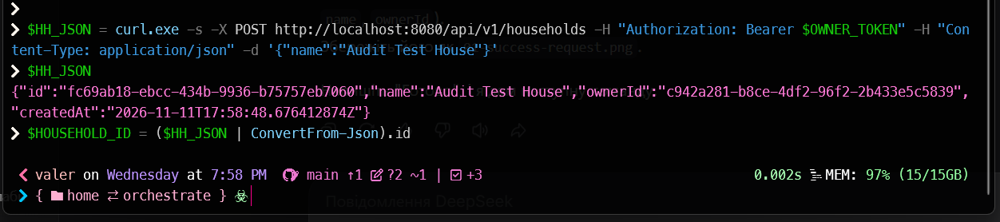
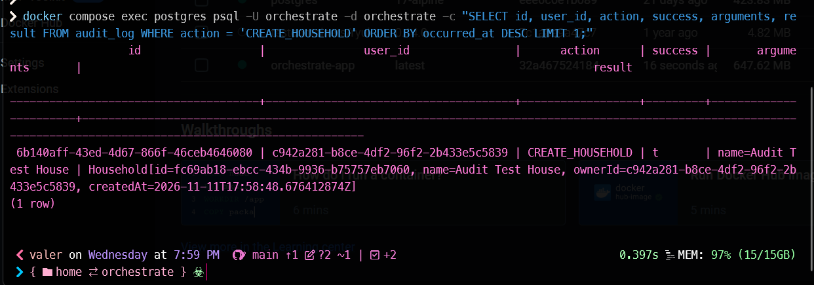
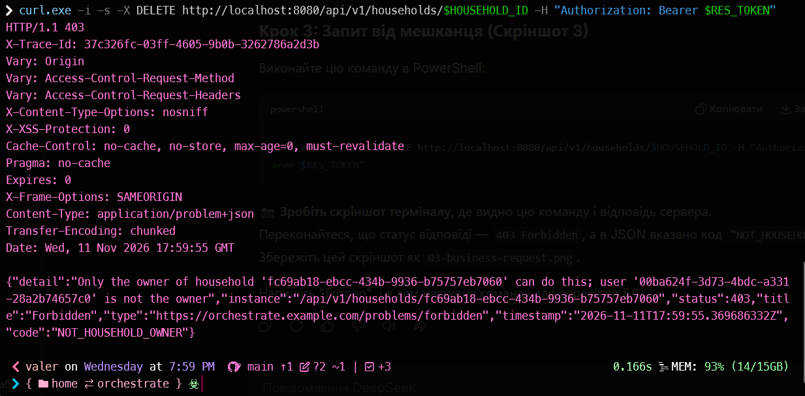
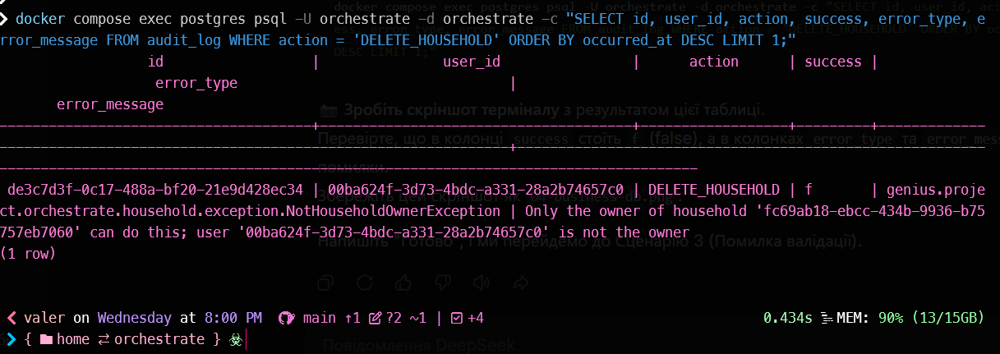
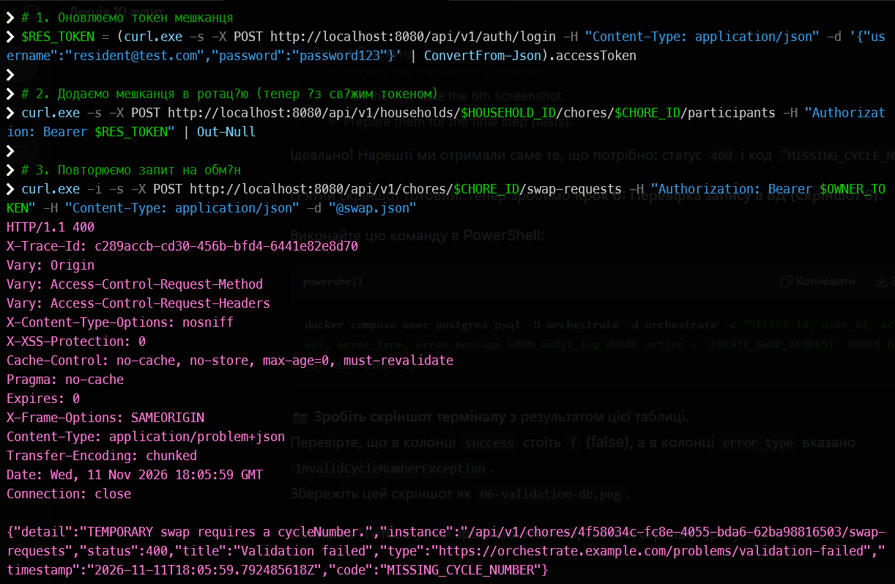
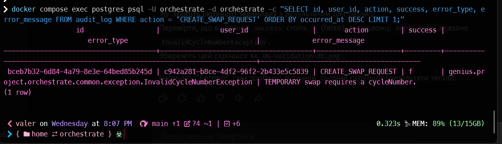
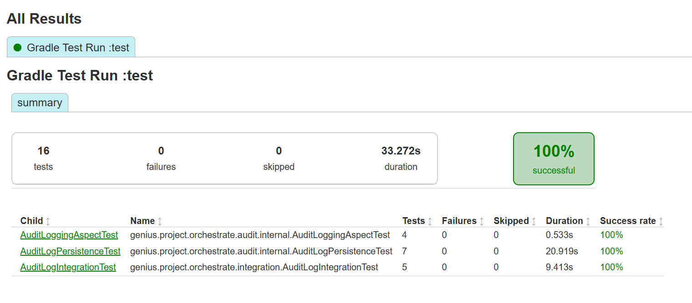

# Звіт: Аспектний аудит бізнес-операцій (Лекція 10)

## 1. Опис реалізації
Підсистема аудиту реалізована за допомогою Spring AOP. Створено кастомну анотацію `@AuditAction`, яка додається до бізнес-методів. Аспект `AuditLoggingAspect` перехоплює виклики цих методів (через `@Around`), вимірює час виконання, фіксує користувача, аргументи, результат та помилки.

**Фактичний ланцюжок збереження:**
`AuditLoggingAspect` передає сформований `AuditRecord` у `AuditLogService`. Реалізація `JpaAuditLogService` викликає `AuditLogWriter`, який безпосередньо зберігає сутність через `AuditLogRepository`. 

Для гарантії збереження записів навіть при відкаті бізнес-транзакції (наприклад, через `ValidationException` або `BusinessRuleViolationException`) використовується `@Transactional(propagation = Propagation.REQUIRES_NEW)` на рівні `AuditLogWriter` (та продубльовано в override методу `save` у `AuditLogRepository`). Оригінальний виняток бізнес-методу не поглинається аспектом, а коректно прокидається далі.

## 2. Результати перевірки

### 2.1. Успішна операція (створення дому)
**Запит:**
```http
POST /api/v1/households
Authorization: Bearer <token>
Content-Type: application/json

{"name":"Audit Test House"}
```


**Запис у БД (`audit_log`):**


### 2.2. Бізнес-помилка (спроба видалити дім не-власником)
**Запит:**
```http
DELETE /api/v1/households/{id}
Authorization: Bearer <resident_token>
```


**Запис у БД (`audit_log`):**


### 2.3. Помилка валідації (некоректний запит на обмін)
**Запит (навмисно без cycleNumber):**
```http
POST /api/v1/chores/{id}/swap-requests
Authorization: Bearer <owner_token>
Content-Type: application/json

{
  "receiverUserId": "00ba624f-3d73-4bdc-a331-28a2b74657c0",
  "swapType": "TEMPORARY"
}
```


**Запис у БД (`audit_log`):**


## 3. Результати виконання тестів
Нижче наведено результати запуску тестів, що перевіряють роботу аудиту (включаючи перевірку збереження при помилках валідації та обрізання довгих рядків `arguments`, `result`, `errorMessage`).



## 4. Висновки
- Аспект успішно перехоплює методи, позначені `@AuditAction`, і фіксує всі необхідні атрибути.
- Завдяки `REQUIRES_NEW` записи аудиту зберігаються навіть при виникненні помилок бізнес-логіки або валідації (що підтверджено як ручними запитами, так і інтеграційними тестами).
- Оригінальні винятки не маскуються і коректно повертаються клієнту у форматі ProblemDetail.
- Всі три типи текстових полів (`arguments`, `result`, `errorMessage`) коректно обрізаються при перевищенні лімітів БД, що підтверджується persistence-тестами.
