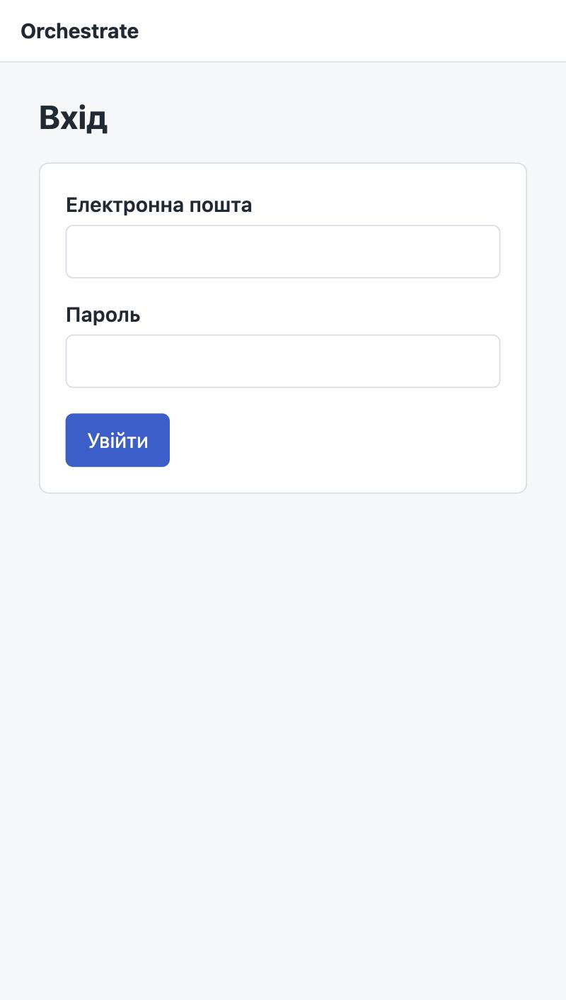
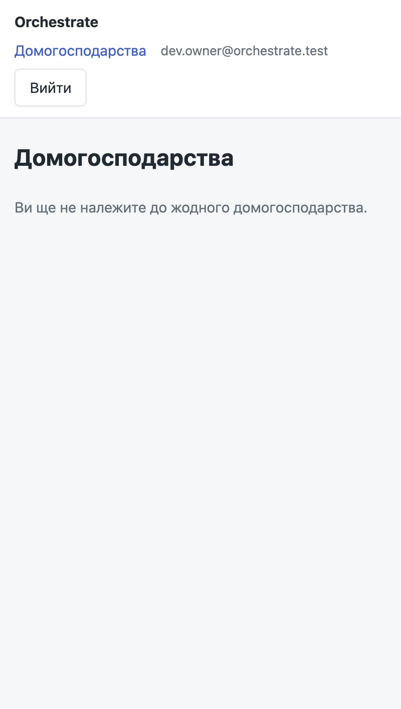
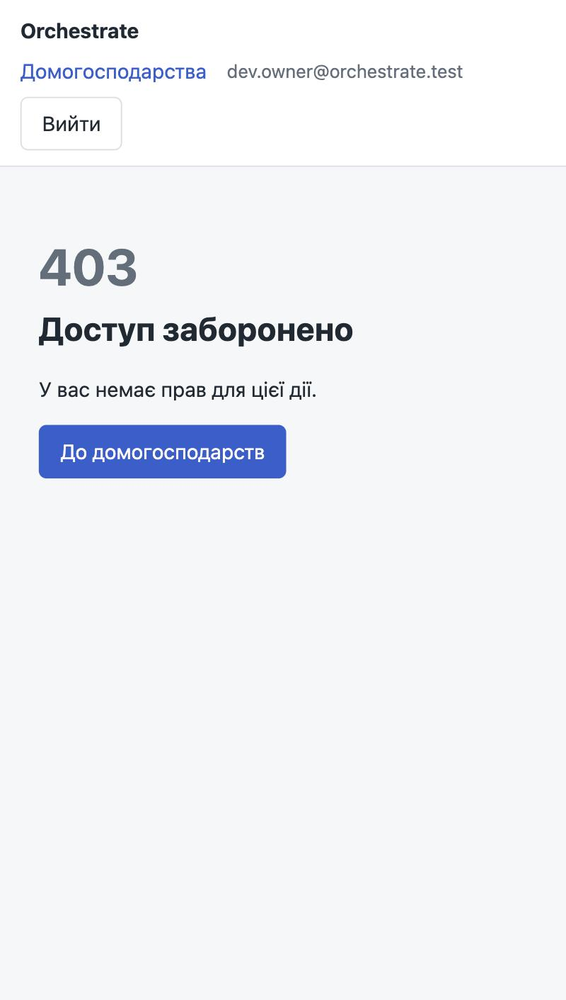
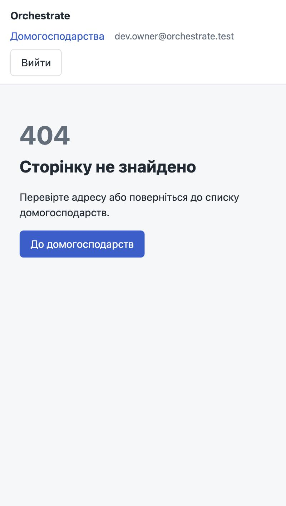
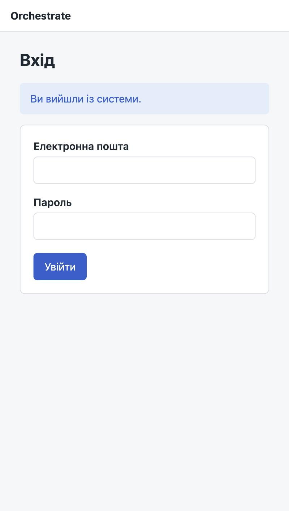
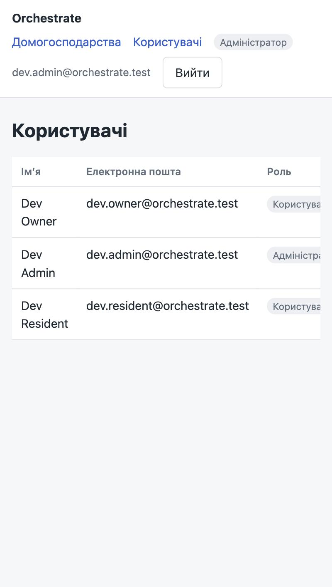

# Звіт: веб-інтерфейс, ролі та безпека (Thymeleaf)

Гілка: `andrii-web-ui`. Основа: `origin/main` (PR #15, веб-безпека chore).

## 1. Що реалізовано

| Вимога (лекція 7, групове завдання) | Реалізація |
|---|---|
| Фрагменти навігації, імені й виходу | `templates/fragments/layout.html`: `head(title)` і `header` через `th:fragment`, підключаються до всіх сторінок через `th:replace` |
| Статика з версіонуванням за хешем | `spring.web.resources.chain.*` у `application.properties`; посилання `/css/app-<hash>.css` (перевірено тестом), `Cache-Control: max-age=31536000, public` |
| Сторінка входу з повідомленнями | `templates/login.html`, `addViewController("/login")` у `common/web/WebViewConfiguration`; повідомлення про помилку і про вихід через `param.error` / `param.logout` |
| Сторінки помилок у стилі проєкту | `error/403.html`, `error/404.html`, `error/5xx.html`, `error/error.html` (для 400, 409, 422) |
| Ролі в шаблонах (`sec:authorize`, `sec:authentication`) | ім'я в шапці (`sec:authentication="name"`), посилання «Користувачі» і бейдж «Адміністратор» тільки для ADMIN (`sec:authorize`) |
| Наскрізна перевірка анонім / USER / ADMIN | `WebUiIntegrationTest`, `UserAdminWebControllerTest`, `HouseholdWebControllerTest`, `WebErrorAdviceTest`, ручний сценарій з `curl` і браузером (розділ 3) |
| Екранування `<script>` | тест `list_EscapesHouseholdName`: назва дому виводиться як `&lt;script&gt;…`, сирого тегу немає |
| Поле `_csrf` у формах | тест входу перевіряє `name="_csrf"` у формі входу і в формі виходу шапки |
| PRG | створення обов'язку (`ChoreWebController`) повертає редирект після POST |

## 2. Ланцюги безпеки

| Порядок | Ланцюг | Захист | Для чого |
|---|---|---|---|
| `@Order(1)` | `apiFilterChain`, `/api/**` | stateless, JWT (`Authorization: Bearer`), CSRF вимкнено | REST API; помилки 401/403 у форматі RFC 9457 |
| `@Order(2)` | `webFilterChain`, решта запитів | сесія (`formLogin`), CSRF увімкнено, CSP, `Referrer-Policy` | Thymeleaf-сторінки |

Публічні маршрути вебінтерфейсу: `/login`, `/css/**`, `/js/**`, `/error`. Усе інше вимагає входу; анонім перенаправляється на `/login`.

## 3. Ролі

- Колонка `users.role` (`V3__user_roles.sql`): `USER` за замовчуванням, `CHECK (role IN ('USER','ADMIN'))`.
- Перевірка ролі: бін `roleAccess` (`identity/RoleAccess.java`) читає роль з БД при кожному запиті. Його використовують `@PreAuthorize`, `sec:authorize` і нова сторінка адміна.
- Dev-профіль: `dev.admin@orchestrate.test` отримує `ADMIN` після старту (`identity/internal/DevAdminRoleAssignment`).

### Коди відповідей (перевірено `curl` на dev-профілі)

| Запит | Хто | Код | Результат |
|---|---|---|---|
| `GET /households` | анонім | 302 | редирект на `/login` |
| `GET /admin/users` | анонім | 302 | редирект на `/login` |
| `GET /households` | USER | 200 | список домогосподарств |
| `GET /admin/users` | USER | 403 | сторінка `error/403` |
| `GET /admin/users` | ADMIN | 200 | список користувачів з ролями |
| `GET /no-such-page` | USER | 404 | сторінка `error/404` (HTML) |
| `GET /api/v1/users/me` | анонім | 401 | ProblemDetail `AUTHENTICATION_REQUIRED` |
| `GET /api/v1/no-such` | анонім | 401 | API-ланцюг вимагає токен |

## 4. Знімки екрана

**Вхід для анонімного користувача**



**Звичайний користувач (USER): список домогосподарств, без пункту «Користувачі»**



**Звичайний користувач (USER): спроба відкрити адмін-розділ, 403**



**Звичайний користувач (USER): неіснуюча сторінка, 404**



**Повідомлення після виходу**



**Адміністратор (ADMIN): розділ «Користувачі», роль у шапці**



Сторінка 5xx в знімках не відображена: її перевіряє тест `unexpectedError_Returns500Page` (статус 500, шаблон `error/5xx`, без тексту винятку).

## 5. Тести

- Усього: 525, падінь: 0 (`sh ./gradlew test`).
- Нові тести: `WebUiIntegrationTest`, `HouseholdWebControllerTest`, `UserAdminWebControllerTest`, `RoleAccessTest`, `WebErrorAdviceTest` (розширено).
- Модульність (`ModularityTests`) зелена: вебкод у `common/web`, `household/web`, `identity/web`; залежності не циклічні.

## 6. Відхилення від лекції і обмеження

1. **`hasRole('ADMIN')` замість ролі в `GrantedAuthority`.** `UserPrincipal` (код іншого учасника) повертає лише `ROLE_USER`, і змінювати його заборонено. Роль читається з БД через `roleAccess.hasRole(authentication, 'ADMIN')`. Поведінка еквівалентна, але вираз інший, ніж у лекції.
2. **BFF (`@Order(2)`) не реалізовано.** Номери ланцюгів у проєкті: API `@Order(1)`, веб `@Order(2)`.
3. **Немає Brotli / `EncodedResourceResolver`**, немає `messages.properties` і `LocaleChangeInterceptor`. Їх не вимагає завдання.
4. **Сторінки обов'язків (`chore/web`) не переведені на фрагменти**: це код іншого учасника, його шаблони лишилися як були.
5. **На вузькому екрані** таблиці прокручуються по горизонталі (`table-wrap`), а не переносяться.
6. **Dev-профіль** створює користувачів з відомим паролем. В `prod` цього немає.

## 7. Як перевірити

```bash
sh ./gradlew test
```

```bash
SPRING_PROFILES_ACTIVE=dev sh ./gradlew bootRun
```

Вхід: `dev.owner@orchestrate.test` (USER) або `dev.admin@orchestrate.test` (ADMIN), пароль `dev-password-123`. Адмін-розділ: `/admin/users`.
